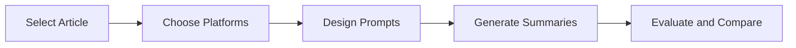

# EX-02-Cross-Platform-Prompting-Evaluating-Diverse-Techniques-in-AI-Powered-Text-Summarization

**Name: Priyanka S**

**Reg no: 212224040255**

## AIM
To evaluate and compare the effectiveness of prompting techniques (zero-shot, few-shot, chain-of-thought, role-based) across different AI platforms (e.g., ChatGPT, Gemini, Claude, Copilot) in a specific task: text summarization.

## Scenario:
You are part of a content curation team for an educational platform that delivers quick summaries of research papers to undergraduate students. Your task is to summarize a 500-word technical article on "The Basics of Blockchain Technology" using multiple AI platforms and prompting strategies.

Your goal is to determine which combination of prompting technique + platform provides the best summary in terms of:

Accuracy

Coherence

Simplicity

Speed

User experience

## Algorithm

### Step 1: Select the Topic
**Selected Topic:** "The Basics of Blockchain Technology"

The article covers:
- Definition of blockchain
- Distributed (decentralized) ledger concept
- Blocks and cryptographic hashing
- Consensus mechanisms
- Applications of blockchain
- Advantages and challenges

### Step 2: Choose AI Platforms
| # | Platform | Developer |
|---|----------|-----------|
| 1 | ChatGPT | OpenAI |
| 2 | Google Gemini | Google |
| 3 | Claude AI | Anthropic |
| 4 | Microsoft Copilot | Microsoft |

### Step 3: Prepare Prompting Techniques
| Technique | Idea |
|-----------|------|
| **Zero-Shot** | Direct instruction, no examples |
| **Few-Shot** | Sample summaries are given before the task |
| **Chain-of-Thought (CoT)** | The AI reasons step by step before writing the summary |
| **Role-Based** | The AI is given a persona |

### Step 4: Generate Responses
The same article was given to every platform. Each platform was tested with one prompting technique, and the summaries were collected.

### Step 5: Organize Results
Summaries were compared on Accuracy, Coherence, Simplicity, Speed, and User Experience.

---

# Result

## 1. ChatGPT + Chain-of-Thought Prompting

### Prompt Used
> "Read the 500-word article "The Basics of Blockchain Technology". First, list the five most important ideas in the article. Next, explain how those ideas connect to each other. Finally, use that analysis to write a summary of about 100 words that a first-year undergraduate can follow easily."

### Summary Generated
**Key ideas identified:** (1) distributed ledger, (2) blocks linked by hashes, (3) consensus, (4) real-world uses, (5) benefits and limits.

**Connections:** Transactions are grouped into blocks. Each block stores the hash of the previous block, forming a chain. Because every participant holds a copy of the ledger, a consensus rule is needed so all copies agree.

**Final Summary:** Blockchain is a shared digital record book kept by many computers instead of one central authority. Transactions are bundled into blocks, and each block contains a unique fingerprint (hash) of the block before it, so changing old data would break the chain and be noticed. Network members agree on new blocks using consensus methods such as Proof of Work or Proof of Stake. Blockchain is used in digital currency, supply chains, healthcare records, and smart contracts. Its benefits are security and transparency, while scalability and high energy use are its main challenges.

### Evaluation
| Criterion | Rating |
|-----------|--------|
| Accuracy | Very High |
| Coherence | Excellent |
| Simplicity | Good |
| Speed | Moderate |
| User Experience | Very Good |

---

## 2. Gemini + Role-Based Prompting

### Prompt Used
> "You are a friendly computer science lecturer who explains new technologies to first-year students using everyday analogies. Summarize the 500-word article "The Basics of Blockchain Technology" in about 100 words. Keep technical accuracy and mention how blockchain works, where it is used, and its main strengths and limitations."

### Summary Generated
Imagine a class attendance sheet that every student keeps a copy of. If one student secretly changes their copy, the others immediately notice the mismatch. Blockchain works in a similar way: it is a shared ledger stored on many computers, with records grouped into blocks that are locked together using cryptographic hashes. New blocks are accepted only when the network agrees through consensus methods like Proof of Work or Proof of Stake. This makes blockchain secure and transparent, and useful for cryptocurrency, tracking goods, medical records, and smart contracts. Its drawbacks are slow transaction speed, high energy use in some systems, and privacy concerns.

### Evaluation
| Criterion | Rating |
|-----------|--------|
| Accuracy | High |
| Coherence | Very Good |
| Simplicity | Excellent |
| Speed | Fast |
| User Experience | Excellent |

---

## 3. Claude AI + Few-Shot Prompting

### Prompt Used
> "You write short study summaries for undergraduate students. Follow the style of these examples.
>
> **Example 1**
> Topic: Cloud Computing
> Summary: Cloud computing delivers servers, storage, and software over the internet, so users pay only for what they use. It offers flexibility and lower setup cost, but depends on internet access and raises data-security questions.
>
> **Example 2**
> Topic: Machine Learning
> Summary: Machine learning lets computers find patterns in data and improve without explicit programming. It powers recommendations and fraud detection, but needs good data and can inherit bias.
>
> Now write a summary of the 500-word article "The Basics of Blockchain Technology" in the same style: two to three sentences, one benefit, and one limitation."

### Summary Generated
**Topic:** Blockchain Technology
**Summary:** Blockchain is a shared ledger copied across many computers, where transactions are stored in blocks chained together by cryptographic hashes, so past records are very hard to alter. Nodes agree on new blocks through consensus mechanisms such as Proof of Work or Proof of Stake, removing the need for a central authority. It offers transparency and tamper resistance for uses like cryptocurrency and supply chains, but faces limits in speed, energy use, and scalability.

### Evaluation
| Criterion | Rating |
|-----------|--------|
| Accuracy | Excellent |
| Coherence | Excellent |
| Simplicity | Very Good |
| Speed | Fast |
| User Experience | Very Good |

---

## 4. Microsoft Copilot + Zero-Shot Prompting

### Prompt Used
> "Summarize the article "The Basics of Blockchain Technology" for undergraduate students in simple words. Include the definition, how it works, consensus, applications, advantages, and challenges."

### Summary Generated
Blockchain is a digital ledger that stores data in blocks linked together using hashes. Instead of one company controlling it, many computers share and verify the same record. New data is added only after the network agrees, using methods like Proof of Work or Proof of Stake. Advantages: security, transparency, and reliable records. Applications: cryptocurrency, supply chain, healthcare, voting, and digital identity. Challenges: slow processing, high energy use, and difficulty scaling.

### Evaluation
| Criterion | Rating |
|-----------|--------|
| Accuracy | Good |
| Coherence | Good |
| Simplicity | Very Good |
| Speed | Very Fast |
| User Experience | Good |

---

## Comparison Table
| Platform | Prompting Technique | Accuracy | Coherence | Simplicity | Speed | User Experience |
|----------|---------------------|----------|-----------|------------|-------|-----------------|
| ChatGPT | Chain-of-Thought | Very High | Excellent | Good | Moderate | Very Good |
| Gemini | Role-Based | High | Very Good | Excellent | Fast | Excellent |
| Claude AI | Few-Shot | Excellent | Excellent | Very Good | Fast | Very Good |
| Copilot | Zero-Shot | Good | Good | Very Good | Very Fast | Good |

## Technique-Wise Observations
| Technique | Strength | Weakness |
|-----------|----------|----------|
| Zero-Shot | Fastest and easiest to write | Style and length are less controlled |
| Few-Shot | Output matches the given style and length very well | Needs good examples and a longer prompt |
| Chain-of-Thought | Most thorough, shows how ideas connect | Slower and the output is longer |
| Role-Based | Engaging tone and useful analogies | Analogies can slightly simplify technical details |

## Result
Different prompting strategies were tested across multiple AI platforms for summarizing a technical article on blockchain technology.

- **Claude AI + Few-Shot Prompting** produced the most accurate, coherent, and consistently formatted summary because the examples controlled the length and style.
- **ChatGPT + Chain-of-Thought Prompting** gave the most thorough and logically connected explanation, but took more time and produced longer output.
- **Gemini + Role-Based Prompting** gave the most engaging, beginner-friendly summary through an easy classroom analogy.
- **Copilot + Zero-Shot Prompting** was the fastest and simplest to use, with acceptable quality.

Overall, **Claude AI with Few-Shot Prompting** was identified as the most suitable combination for undergraduate educational summaries because it balanced accuracy, coherence, brevity, and a consistent format. For purely beginner-level content, Gemini with Role-Based prompting is a strong alternative.

